<!--
Aurora Australis: repository-local SVG artwork, with light/dark and phone variants.
Edit the prose outside the four generated boundaries normally.
Writing, project metadata, pulse and sign-off are rebuilt from validated public data.
See PROFILE.md for local reproduction, refresh behavior and activation prerequisites.
-->

<a href="https://ricky-g.com"><picture>
<source media="(prefers-color-scheme: dark) and (max-width: 600px) and (prefers-reduced-motion: no-preference)" srcset="assets/hero-phone-dark.svg#motion">
<source media="(prefers-color-scheme: light) and (max-width: 600px) and (prefers-reduced-motion: no-preference)" srcset="assets/hero-phone-light.svg#motion">
<source media="(prefers-color-scheme: dark) and (min-width: 601px) and (prefers-reduced-motion: no-preference)" srcset="assets/hero-dark.svg#motion">
<source media="(prefers-color-scheme: light) and (min-width: 601px) and (prefers-reduced-motion: no-preference)" srcset="assets/hero-light.svg#motion">
<source media="(prefers-color-scheme: dark) and (max-width: 600px)" srcset="assets/hero-phone-dark.svg"><source media="(max-width: 600px)" srcset="assets/hero-phone-light.svg"><source media="(prefers-color-scheme: dark)" srcset="assets/hero-dark.svg"></picture></a>

<a href="https://clouddev.blog"><picture><source media="(prefers-color-scheme: dark)" srcset="assets/pill-blog-dark.svg"></picture></a><a href="https://ricky-g.com"><picture><source media="(prefers-color-scheme: dark)" srcset="assets/pill-site-dark.svg"></picture></a><a href="https://www.linkedin.com/in/rickygummadi"><picture><source media="(prefers-color-scheme: dark)" srcset="assets/pill-linkedin-dark.svg"></picture></a>

<strong>Cloud &amp; AI Solution Architect · Auckland, NZ</strong> <strong>Engineer at heart.</strong> I design cloud architectures, build AI systems you can trust, and create developer platforms that accelerate delivery. I write about the journey on <a href="https://clouddev.blog">my blog</a>.

<strong>About me</strong> I'm an engineer from Auckland, passionate about cloud, AI, and startups. I build scalable systems, govern AI agents, and obsess over developer experience, turning gnarly architecture into things that actually ship.

<h2><picture>
<source media="(prefers-color-scheme: dark) and (max-width: 600px) and (prefers-reduced-motion: no-preference)" srcset="assets/label-writing-phone-dark.svg#motion">
<source media="(prefers-color-scheme: light) and (max-width: 600px) and (prefers-reduced-motion: no-preference)" srcset="assets/label-writing-phone-light.svg#motion">
<source media="(prefers-color-scheme: dark) and (min-width: 601px) and (prefers-reduced-motion: no-preference)" srcset="assets/label-writing-dark.svg#motion">
<source media="(prefers-color-scheme: light) and (min-width: 601px) and (prefers-reduced-motion: no-preference)" srcset="assets/label-writing-light.svg#motion">
<source media="(prefers-color-scheme: dark) and (max-width: 600px)" srcset="assets/label-writing-phone-dark.svg"><source media="(max-width: 600px)" srcset="assets/label-writing-phone-light.svg"><source media="(prefers-color-scheme: dark)" srcset="assets/label-writing-dark.svg"></picture></h2>

<!-- WRITING:START -->
<!-- GENERATED:sha256=291c97b9e99f403b4e44fae58a1586e449865a962ee69dd6dd7a9065850321f7 -->

<a href="https://clouddev.blog/GitHub/Copilot/github-copilot-agents-part-2-harnesses-the-agent-host-cloud-sandboxes-and-ai-credits-explained/"><picture><source media="(prefers-color-scheme: dark) and (max-width: 600px) and (prefers-reduced-motion: no-preference)" srcset="assets/generated/post-1-phone-dark.svg#motion"><source media="(prefers-color-scheme: light) and (max-width: 600px) and (prefers-reduced-motion: no-preference)" srcset="assets/generated/post-1-phone-light.svg#motion"><source media="(prefers-color-scheme: dark) and (min-width: 601px) and (prefers-reduced-motion: no-preference)" srcset="assets/generated/post-1-dark.svg#motion"><source media="(prefers-color-scheme: light) and (min-width: 601px) and (prefers-reduced-motion: no-preference)" srcset="assets/generated/post-1-light.svg#motion"><source media="(prefers-color-scheme: dark) and (max-width: 600px)" srcset="assets/generated/post-1-phone-dark.svg"><source media="(max-width: 600px)" srcset="assets/generated/post-1-phone-light.svg"><source media="(prefers-color-scheme: dark)" srcset="assets/generated/post-1-dark.svg"></picture></a> 
<a href="https://clouddev.blog/AI/AI-Engineering/mcp-goes-stateless-no-handshake-no-sticky-sessions-better-ai-gateways/"><picture><source media="(prefers-color-scheme: dark) and (prefers-reduced-motion: no-preference)" srcset="assets/generated/post-2-dark.svg#motion"><source media="(prefers-color-scheme: light) and (prefers-reduced-motion: no-preference)" srcset="assets/generated/post-2-light.svg#motion"><source media="(prefers-color-scheme: dark)" srcset="assets/generated/post-2-dark.svg"></picture></a><a href="https://clouddev.blog/AI/AI-Engineering/agents-md-vs-copilot-instructions-vs-cursor-rules-vs-claude-md-which-ai-context-file-to-use-and-when-2026/"><picture><source media="(prefers-color-scheme: dark) and (prefers-reduced-motion: no-preference)" srcset="assets/generated/post-3-dark.svg#motion"><source media="(prefers-color-scheme: light) and (prefers-reduced-motion: no-preference)" srcset="assets/generated/post-3-light.svg#motion"><source media="(prefers-color-scheme: dark)" srcset="assets/generated/post-3-dark.svg"></picture></a><a href="https://clouddev.blog/archives/"><picture><source media="(prefers-color-scheme: dark) and (prefers-reduced-motion: no-preference)" srcset="assets/generated/archive-dark.svg#motion"><source media="(prefers-color-scheme: light) and (prefers-reduced-motion: no-preference)" srcset="assets/generated/archive-light.svg#motion"><source media="(prefers-color-scheme: dark)" srcset="assets/generated/archive-dark.svg"></picture></a>

<ol>
<li><strong><a href="https://clouddev.blog/GitHub/Copilot/github-copilot-agents-part-2-harnesses-the-agent-host-cloud-sandboxes-and-ai-credits-explained/">GitHub Copilot CLI vs Local vs Cloud: Agents Explained (2026)</a></strong> — 3 Nov 2026 Compare GitHub Copilot CLI, Local and cloud agents in 2026. Learn where the Copilot SDK fits, how sessions run, and what sub-agents and AI Credits cost.</li>
<li><strong><a href="https://clouddev.blog/AI/AI-Engineering/mcp-goes-stateless-no-handshake-no-sticky-sessions-better-ai-gateways/">MCP Goes Stateless: No Handshake, No Sticky Sessions, Better AI Gateways</a></strong> — 20 Oct 2026 MCP 2026-07-28 removes handshakes and sticky sessions. Learn what changes for Azure API Management, per-tool routing, retries, tracing and secure tool access.</li>
<li><strong><a href="https://clouddev.blog/AI/AI-Engineering/agents-md-vs-copilot-instructions-vs-cursor-rules-vs-claude-md-which-ai-context-file-to-use-and-when-2026/">AGENTS.md vs Copilot Instructions vs Cursor Rules vs CLAUDE.md: Which AI Context File to Use, and When (2026)</a></strong> — 26 Jun 2026 A practical guide to AGENTS.md, Copilot instructions, Cursor rules, CLAUDE.md, GEMINI.md and skills. Choose the right context file, understand precedence, and see what the...</li>
</ol>

<a href="https://clouddev.blog/archives/">Explore all 27 published articles →</a>

<!-- WRITING:END -->

<h2><picture>
<source media="(prefers-color-scheme: dark) and (max-width: 600px) and (prefers-reduced-motion: no-preference)" srcset="assets/label-building-phone-dark.svg#motion">
<source media="(prefers-color-scheme: light) and (max-width: 600px) and (prefers-reduced-motion: no-preference)" srcset="assets/label-building-phone-light.svg#motion">
<source media="(prefers-color-scheme: dark) and (min-width: 601px) and (prefers-reduced-motion: no-preference)" srcset="assets/label-building-dark.svg#motion">
<source media="(prefers-color-scheme: light) and (min-width: 601px) and (prefers-reduced-motion: no-preference)" srcset="assets/label-building-light.svg#motion">
<source media="(prefers-color-scheme: dark) and (max-width: 600px)" srcset="assets/label-building-phone-dark.svg"><source media="(max-width: 600px)" srcset="assets/label-building-phone-light.svg"><source media="(prefers-color-scheme: dark)" srcset="assets/label-building-dark.svg"></picture></h2>

<!-- PROJECTS:START -->
<!-- GENERATED:sha256=cc5eb45ae2eb4e6cef82bc394335b49499970377317e60e6007003cb8a6ddd5b -->

<a href="https://github.com/microsoft/agent-governance-toolkit"><picture><source media="(prefers-color-scheme: dark) and (max-width: 600px) and (prefers-reduced-motion: no-preference)" srcset="assets/generated/tile-agt-phone-dark.svg#motion"><source media="(prefers-color-scheme: light) and (max-width: 600px) and (prefers-reduced-motion: no-preference)" srcset="assets/generated/tile-agt-phone-light.svg#motion"><source media="(prefers-color-scheme: dark) and (min-width: 601px) and (prefers-reduced-motion: no-preference)" srcset="assets/generated/tile-agt-dark.svg#motion"><source media="(prefers-color-scheme: light) and (min-width: 601px) and (prefers-reduced-motion: no-preference)" srcset="assets/generated/tile-agt-light.svg#motion"><source media="(prefers-color-scheme: dark) and (max-width: 600px)" srcset="assets/generated/tile-agt-phone-dark.svg"><source media="(max-width: 600px)" srcset="assets/generated/tile-agt-phone-light.svg"><source media="(prefers-color-scheme: dark)" srcset="assets/generated/tile-agt-dark.svg"></picture></a><a href="https://github.com/Ricky-G/azure-scenario-hub"><picture><source media="(prefers-color-scheme: dark) and (prefers-reduced-motion: no-preference)" srcset="assets/generated/tile-hub-dark.svg#motion"><source media="(prefers-color-scheme: light) and (prefers-reduced-motion: no-preference)" srcset="assets/generated/tile-hub-light.svg#motion"><source media="(prefers-color-scheme: dark)" srcset="assets/generated/tile-hub-dark.svg"></picture></a> 
<a href="https://github.com/Ricky-G/docker-ai-models"><picture><source media="(prefers-color-scheme: dark) and (prefers-reduced-motion: no-preference)" srcset="assets/tile-docker-dark.svg#motion"><source media="(prefers-color-scheme: light) and (prefers-reduced-motion: no-preference)" srcset="assets/tile-docker-light.svg#motion"><source media="(prefers-color-scheme: dark)" srcset="assets/tile-docker-dark.svg"></picture></a><a href="https://github.com/Ricky-G/ledgerboard"><picture><source media="(prefers-color-scheme: dark) and (prefers-reduced-motion: no-preference)" srcset="assets/tile-ledgerboard-dark.svg#motion"><source media="(prefers-color-scheme: light) and (prefers-reduced-motion: no-preference)" srcset="assets/tile-ledgerboard-light.svg#motion"><source media="(prefers-color-scheme: dark)" srcset="assets/tile-ledgerboard-dark.svg"></picture></a><a href="https://ricky-g.com"><picture><source media="(prefers-color-scheme: dark) and (prefers-reduced-motion: no-preference)" srcset="assets/tile-arcade-dark.svg#motion"><source media="(prefers-color-scheme: light) and (prefers-reduced-motion: no-preference)" srcset="assets/tile-arcade-light.svg#motion"><source media="(prefers-color-scheme: dark)" srcset="assets/tile-arcade-dark.svg"></picture></a>

<strong><a href="https://github.com/microsoft/agent-governance-toolkit">Agent Governance Toolkit</a></strong> — policy enforcement, zero-trust identity, execution sandboxing and reliability engineering for autonomous AI agents. The project reports OWASP Agentic Top 10 coverage.

<strong><a href="https://github.com/Ricky-G/azure-scenario-hub">Azure Scenario Hub</a></strong> — deployable Azure and Microsoft AI scenarios, runnable demos and benchmarks. <a href="https://clouddev.blog/Azure/APIM/apim-backend-fan-out-shared-backend-rewrite-uri-vs-one-backend-per-api-a-real-benchmark/">Read the APIM benchmark and its methodology →</a>

<a href="https://github.com/Ricky-G/docker-ai-models">docker-ai-models</a> · <a href="https://github.com/Ricky-G/ledgerboard">ledgerboard</a> · <a href="https://ricky-g.com">The mini arcade</a>

<!-- PROJECTS:END -->

<h2><picture>
<source media="(prefers-color-scheme: dark) and (max-width: 600px) and (prefers-reduced-motion: no-preference)" srcset="assets/label-stack-phone-dark.svg#motion">
<source media="(prefers-color-scheme: light) and (max-width: 600px) and (prefers-reduced-motion: no-preference)" srcset="assets/label-stack-phone-light.svg#motion">
<source media="(prefers-color-scheme: dark) and (min-width: 601px) and (prefers-reduced-motion: no-preference)" srcset="assets/label-stack-dark.svg#motion">
<source media="(prefers-color-scheme: light) and (min-width: 601px) and (prefers-reduced-motion: no-preference)" srcset="assets/label-stack-light.svg#motion">
<source media="(prefers-color-scheme: dark) and (max-width: 600px)" srcset="assets/label-stack-phone-dark.svg"><source media="(max-width: 600px)" srcset="assets/label-stack-phone-light.svg"><source media="(prefers-color-scheme: dark)" srcset="assets/label-stack-dark.svg"></picture></h2>

<picture>
<source media="(prefers-color-scheme: dark) and (max-width: 600px) and (prefers-reduced-motion: no-preference)" srcset="assets/stack-phone-dark.svg#motion">
<source media="(prefers-color-scheme: light) and (max-width: 600px) and (prefers-reduced-motion: no-preference)" srcset="assets/stack-phone-light.svg#motion">
<source media="(prefers-color-scheme: dark) and (min-width: 601px) and (prefers-reduced-motion: no-preference)" srcset="assets/stack-dark.svg#motion">
<source media="(prefers-color-scheme: light) and (min-width: 601px) and (prefers-reduced-motion: no-preference)" srcset="assets/stack-light.svg#motion">
<source media="(prefers-color-scheme: dark) and (max-width: 600px)" srcset="assets/stack-phone-dark.svg"><source media="(max-width: 600px)" srcset="assets/stack-phone-light.svg"><source media="(prefers-color-scheme: dark)" srcset="assets/stack-dark.svg"></picture>

<strong>Agents &amp; AI</strong> — GitHub Copilot · MCP · Microsoft Agent Framework · Semantic Kernel · Microsoft Foundry · Azure OpenAI <strong>Cloud platform</strong> — Azure · AKS · API Management · Container Apps · Functions · Bicep · Terraform · Docker <strong>Languages</strong> — C# · .NET · Python · TypeScript · PowerShell <strong>Across every layer</strong> — Agent Governance Toolkit · Entra ID · Private Link · Azure Monitor

<h2><picture>
<source media="(prefers-color-scheme: dark) and (max-width: 600px) and (prefers-reduced-motion: no-preference)" srcset="assets/label-pulse-phone-dark.svg#motion">
<source media="(prefers-color-scheme: light) and (max-width: 600px) and (prefers-reduced-motion: no-preference)" srcset="assets/label-pulse-phone-light.svg#motion">
<source media="(prefers-color-scheme: dark) and (min-width: 601px) and (prefers-reduced-motion: no-preference)" srcset="assets/label-pulse-dark.svg#motion">
<source media="(prefers-color-scheme: light) and (min-width: 601px) and (prefers-reduced-motion: no-preference)" srcset="assets/label-pulse-light.svg#motion">
<source media="(prefers-color-scheme: dark) and (max-width: 600px)" srcset="assets/label-pulse-phone-dark.svg"><source media="(max-width: 600px)" srcset="assets/label-pulse-phone-light.svg"><source media="(prefers-color-scheme: dark)" srcset="assets/label-pulse-dark.svg"></picture></h2>

<!-- PULSE:START -->
<!-- GENERATED:sha256=7b3ba550ce62a4f82ff0e818fa32e28fe68eb74f6fdc2e6b398086c523270166 -->

<picture><source media="(prefers-color-scheme: dark) and (max-width: 600px) and (prefers-reduced-motion: no-preference)" srcset="assets/generated/pulse-phone-dark.svg#motion"><source media="(prefers-color-scheme: light) and (max-width: 600px) and (prefers-reduced-motion: no-preference)" srcset="assets/generated/pulse-phone-light.svg#motion"><source media="(prefers-color-scheme: dark) and (min-width: 601px) and (prefers-reduced-motion: no-preference)" srcset="assets/generated/pulse-dark.svg#motion"><source media="(prefers-color-scheme: light) and (min-width: 601px) and (prefers-reduced-motion: no-preference)" srcset="assets/generated/pulse-light.svg#motion"><source media="(prefers-color-scheme: dark) and (max-width: 600px)" srcset="assets/generated/pulse-phone-dark.svg"><source media="(max-width: 600px)" srcset="assets/generated/pulse-phone-light.svg"><source media="(prefers-color-scheme: dark)" srcset="assets/generated/pulse-dark.svg"></picture>

<strong>1,230 contributions</strong> shown on the public GitHub profile · 129 public repositories · 27 published articles.

Public-repository activity: 266 commits, 146 pull requests, 100 issues and 23 reviews across 36 public repositories. The type mix can differ from the public calendar total, which also counts other contribution types and any anonymous aggregates the owner has chosen to make public.

<!-- PULSE:END -->

<h2><picture>
<source media="(prefers-color-scheme: dark) and (max-width: 600px) and (prefers-reduced-motion: no-preference)" srcset="assets/label-arcade-phone-dark.svg#motion">
<source media="(prefers-color-scheme: light) and (max-width: 600px) and (prefers-reduced-motion: no-preference)" srcset="assets/label-arcade-phone-light.svg#motion">
<source media="(prefers-color-scheme: dark) and (min-width: 601px) and (prefers-reduced-motion: no-preference)" srcset="assets/label-arcade-dark.svg#motion">
<source media="(prefers-color-scheme: light) and (min-width: 601px) and (prefers-reduced-motion: no-preference)" srcset="assets/label-arcade-light.svg#motion">
<source media="(prefers-color-scheme: dark) and (max-width: 600px)" srcset="assets/label-arcade-phone-dark.svg"><source media="(max-width: 600px)" srcset="assets/label-arcade-phone-light.svg"><source media="(prefers-color-scheme: dark)" srcset="assets/label-arcade-dark.svg"></picture></h2>

<picture>
<source media="(prefers-color-scheme: dark) and (prefers-reduced-motion: no-preference)" srcset="assets/generated/snake-dark.svg#motion">
<source media="(prefers-color-scheme: light) and (prefers-reduced-motion: no-preference)" srcset="assets/generated/snake-light.svg#motion">
<source media="(prefers-color-scheme: dark)" srcset="assets/generated/snake-dark.svg"></picture>

<a href="https://ricky-g.com">Play snake and minesweeper on ricky-g.com →</a>

<!-- SIGNOFF:START -->
<!-- GENERATED:sha256=095e23c0f34b69bdf71e0608ba06e13de19039db4b1f8a08fb28e8acb842efb2 -->

<a href="https://www.linkedin.com/in/rickygummadi"><picture><source media="(prefers-color-scheme: dark) and (max-width: 600px) and (prefers-reduced-motion: no-preference)" srcset="assets/generated/signoff-phone-dark.svg#motion"><source media="(prefers-color-scheme: light) and (max-width: 600px) and (prefers-reduced-motion: no-preference)" srcset="assets/generated/signoff-phone-light.svg#motion"><source media="(prefers-color-scheme: dark) and (min-width: 601px) and (prefers-reduced-motion: no-preference)" srcset="assets/generated/signoff-dark.svg#motion"><source media="(prefers-color-scheme: light) and (min-width: 601px) and (prefers-reduced-motion: no-preference)" srcset="assets/generated/signoff-light.svg#motion"><source media="(prefers-color-scheme: dark) and (max-width: 600px)" srcset="assets/generated/signoff-phone-dark.svg"><source media="(max-width: 600px)" srcset="assets/generated/signoff-phone-light.svg"><source media="(prefers-color-scheme: dark)" srcset="assets/generated/signoff-dark.svg"></picture></a>

Off the clock? I&#x27;m still building AI and AI agents, exploring emerging tech, and chasing far too many side projects. I love meeting founders and building crazy, impossible ideas together, so if that&#x27;s you, let&#x27;s talk.

Public-data snapshot: 8 Nov 2026, 17:32 NZDT. <a href="https://www.linkedin.com/in/rickygummadi">Let’s make something →</a>

<!-- SIGNOFF:END -->

Plain Markdown and self-contained SVG. All profile images live in this repository; no live third-party widgets or JavaScript.

